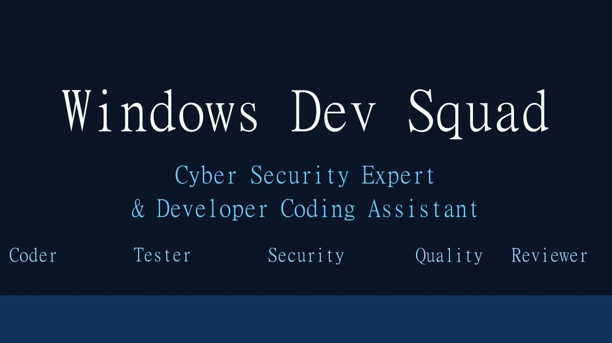

# Windows Dev Squad (`squad`)

<p align="center">
  <a href="docs/media/squad-intro.mp4">
    
  </a>
</p>

A Windows-first dual toolkit serving as a **Cyber Security Expert** & **Developer Coding Assistant** powered by a crew of named agents (coordinator, coder, tester, security reviewer, quality reviewer).

- **Security Expert (`squad security`)**: Multi-phase security scanning (Nightwing Phase A/B/C), Alfred tool manager, Oracle reports (PDF/HTML/MD/CSV/JIRA), SQLite history, role-based access, and signed audit logs.
- **Developer Coding Assistant (`squad dev`)**: Vibe-coding assistant, automated code reviews with quality scores, `pytest` unit test generator, and automated code refactoring.
- **Real-Time Intelligence (`squad intel`)**: Online harvester fetching real-time security advisories (CVEs, GitHub Advisories) and modern coding standards to continuously train and augment agents with live data.
- **Conversational Assistant (`squad chat`)**: A two-tier chatbot — a rule-based offline tier that turns plain English into real `squad` commands, plus an optional LLM tier for research/advanced questions (OpenRouter). A local **TensorFlow** tier adds an intent classifier and a code-security classifier (optional `.[ml]` install) that disambiguate chat messages and flag vulnerable code.
- **Guard & Budget**: Default-deny security guard policy enforcing signed authorization for all scan targets and local repo paths, with hard budget limits.

> **Status: Phases 0–12 complete.** The full Windows Dev Squad is built: skeleton +
> docs + `squad doctor`, the default-deny **guard**, the **executor** (Job
> Objects, scrubbed env, git hardening, OS adapter), `squad check`, the **budget
> layer** + OpenRouter provider, the single **agent loop** + hash-chained audit
> log, the **sequential squad** (`--dry-run`), the live **TUI**, the **parallel
> squad** (worktrees), **attack tests**, the remote **web gateway** (127.0.0.1
> only, passkey+token), the overnight **queue/digest**, and **hardening**
> (config validation, crash recovery, retention, runbook). Tests run offline
> with mocked models and no API keys.

## Important: the guard is NOT a sandbox

The guard is a policy decision layer: it approves or denies *requests* and
checks *arguments*, but it does **not** contain processes. An agent's code runs
inside the isolation level you configure (low-privilege user, Windows Sandbox, a
dev VM, or WSL2/Docker with networking off). The guard alone cannot stop a
compromised process from touching the OS, which is exactly why "any repo that
matters" requires isolation Level 2 or higher. Never treat the guard as a
security boundary between untrusted code and your machine.

## Install (development)

```powershell
python -m venv .venv
.\.venv\Scripts\python.exe -m pip install -e ".[dev]"
```

Then run the CLI:

```powershell
.\.venv\Scripts\squad.exe doctor            # read-only machine/limits report
.\.venv\Scripts\squad.exe doctor --setup-help  # one-time admin setup steps
.\.venv\Scripts\squad.exe --version
```

To enable the optional TensorFlow tier (intent + code-security classifiers for
the chatbot), also install the ML extra and retrain the models:

```powershell
.\.venv\Scripts\python.exe -m pip install -e ".[dev,ml]"
env -u PYTHONPATH .\.venv\Scripts\python.exe -m squad.models.train --epochs 30
```

Without the ML extra, `squad chat` still works — it just relies on the
rule-based offline tier (and the LLM tier if you set `OPENROUTER_API_KEY`).
See `squad/models/README.md` for details on training and inference.

## Package naming

The CLI command is `squad` and the import package is `squad/`, but the PyPI
distribution name is `windows-dev-squad`: the name `squad` is already taken on
PyPI by an unrelated project (Linaro's "Software Quality Dashboard"). This is a
private project and is not published to PyPI.

## Layout

```
squad/            # import package
  cli/            # typer CLI (doctor, setup-help)
  guard/          # default-deny policy decision layer (stdlib only)
  exec/           # executor: OS-adapter, Job Objects, scrubbed env, git hardening
  tools/          # typed tool registry + Tier-0 tools
tests/            # main test suite (pytest, offline, no API keys)
  guard/          # adversarial guard tests
  exec/           # executor / job-object / git-hardening tests
docs/RULES.md     # non-negotiable rules — source of truth, read every phase
docs/SPEC.md      # full specification — source of truth, read every phase
docs/GUIDE.md     # how to install, run, and use what exists
practice/         # throwaway target repo (one failing test; excluded from main run)
squad.yaml        # config template (crew, budget, roles, write scopes)
guard.yaml        # guard policy (tiers, blocked paths, sensitive files)
prices.yaml       # model price template (Phase 4 fills it)
.env.example      # environment template (no values)
.github/workflows/ci.yml  # CI on Windows, Linux, macOS
```

## Development checks

```powershell
.\.venv\Scripts\python.exe -m pytest -q          # tests
.\.venv\Scripts\python.exe -m ruff check .       # lint
.\.venv\Scripts\python.exe -m ruff format --check .  # formatting
.\.venv\Scripts\python.exe -m bandit -r squad -c pyproject.toml  # security scan
.\.venv\Scripts\python.exe -m pip-audit          # dependency audit
```

All tests run offline with no API keys. The real-key smoke test (`squad
providers test`) is opt-in and never runs in CI.

## Guides

- [docs/GUIDE.md](docs/GUIDE.md) — how to install, run, and use what exists today.
- [docs/ISSUES.md](docs/ISSUES.md) — open and fixed issues.
- [docs/RULES.md](docs/RULES.md) — the non-negotiable rules.
- [docs/SPEC.md](docs/SPEC.md) — the full specification.
